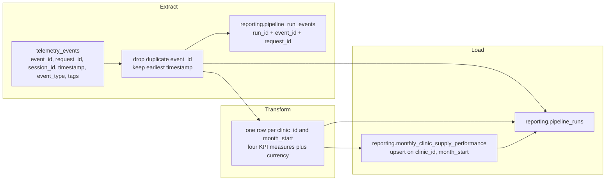

# HealthCore — Business Performance Data Pipeline (Design)

Part 1 of 3. Design only. No Prefect flow, no `services/reporting/` module, and no change to `services/telemetry/analysis.py` or `GET /telemetry/report` in this part.

Audience: Dr. Okonkwo (CEO) and Claire (Chief Compliance Officer).
Cadence: monthly, ready on the first working day, for the previous calendar month in UTC.
Deliverable: the Monthly Clinic Supply Performance Report.

Regulatory boundary: the data-pipelines briefing aggregates by clinic and by department, and it forbids a patient identifier. Published rows use the destination grain `clinic_id`, `country`, `month_start`. `department` on `outbound_order_created` is one of `primary_care`, `specialty_care`, `chronic_care`, `general_consultation`. It stays on the source event. It is not a column of `reporting.monthly_clinic_supply_performance`. No row, response, or log field carries a patient identifier, diagnosis, staff name, staff email, or any other protected health information. `userId` on the telemetry envelope stays in `telemetry_events`. It is not copied into `reporting`.

## Current State

HealthCore already captures inventory telemetry for the backoffice and the API, and it already has a technical report for engineering.

What is captured:

| `event_type` | Role in this pipeline | Where it is defined |
| --- | --- | --- |
| `inbound_order_created` | Feeds Supply Cost per Clinic | `docs/telemetry/telemetry-plan.md`, `docs/telemetry/event-schemas.json`, `uis/backoffice/src/services/telemetry-catalogue.ts` |
| `outbound_order_created` | Feeds Supply Consumption Volume | same catalogue |
| `stock_threshold_triggered` | Feeds Critical Stockout Frequency | same catalogue |
| `supply_expiry_flagged` | Feeds Expiry Risk Count | same catalogue |

`direct_stock_edit_rejected` is the fifth mandatory event in the telemetry briefing. The data-pipelines briefing does not feed any of the four KPIs from it. v1 does not read it. The other catalogue events (`product_registered`, `login_succeeded`, `api_latency_recorded`, and the rest) stay on the technical report. They are not inputs to v1.

Where those events live:

- The browser builds the envelope in `uis/backoffice/src/services/telemetry.ts` (`eventId`, `timestamp`, `sessionId`, `userId`, `event_type`, `schemaVersion`, `requestId`, `properties`) and posts batches to `POST /telemetry/events`.
- `services/routers/telemetry.py` accepts that batch. In the current phase it validates and returns `{ "received": N }`. It does not write this pipeline's destination.
- The engineering report reads the table `telemetry_events`. `services/telemetry/analysis.py` selects `timestamp`, `event_type`, `level`, `value`, and `tags`, and expands `tags` into columns. Latency metrics already come from that JSON (`duration_ms`, `route_template`).
- `GET /telemetry/report` (`services/telemetry/report.py`) returns `events_per_day`, `error_rate_by_type`, `latency_per_day`, and `auth_failure_rate` for a time window. Default window is the last seven days. The response is cached for 60 seconds.

Clinic vocabulary already in the monorepo (`docs/telemetry/telemetry-plan.md`, section 3), not the sample slug in the briefing example:

| `clinic_id` | `country` | region | currency for this pipeline |
| --- | --- | --- | --- |
| 1, 2, 3 | US | Texas | USD |
| 4, 5, 6 | US | Florida | USD |
| 7, 8, 9 | US | Georgia | USD |
| 10, 11 | UK | London | GBP |
| 12 | UK | Manchester | GBP |

`properties.clinic_id` is an integer from 1 to 12. `properties.country` is `US` or `UK`. `properties.department`, where an outbound event has one, is `primary_care`, `specialty_care`, `chronic_care`, or `general_consultation`. Product categories on the wire are `medication`, `ppe`, `consumable`, and `equipment`. Stock movements in the operational database are `supply_deliveries` and `supply_consumptions` (`services/models.py`). Those tables have quantity, clinic, and vendor or consumption type. They have no cost column. v1 does not join them, and it does not join any patient-level table. There is no patient-level table in this monorepo.

## Business gap

`GET /telemetry/report` answers an engineering question: how many events arrived, which types failed, how slow the API was, and whether logins failed. It does not answer the question Dr. Okonkwo and Claire ask once a month: for each of the 12 clinics, how much supply was purchased, how much consumption was recorded, how often stock crossed the minimum, and how many batches were flagged for expiry.

That gap needs its own pipeline. The technical report keeps its current tables, its current endpoint, and its current calculations.

## Purpose

Produce the monthly, per-clinic rollup that feeds Dr. Okonkwo's Monthly Clinic Supply Performance Report on the first working day, computing Supply Cost per Clinic, Supply Consumption Volume, Critical Stockout Frequency, and Expiry Risk Count from `inbound_order_created`, `outbound_order_created`, `stock_threshold_triggered`, and `supply_expiry_flagged`.

## Extraction format

Source table: `telemetry_events`, read only. This pipeline never inserts, updates, or deletes a row there.

Row shape the extract reads (the columns the technical report already uses, plus the envelope id the dedup key needs):

| Column | Type in the warehouse | Meaning |
| --- | --- | --- |
| `event_id` | `text` | Envelope `eventId`. UUID. Dedup key. |
| `request_id` | `text` | Envelope `requestId`. Stored on the run lineage with `run_id`. Not a KPI dimension. |
| `session_id` | `text`, nullable | Envelope `sessionId`. Compared with event volume as the active-session count. Not copied onto the business row. |
| `timestamp` | `timestamptz` | When the event was emitted, UTC, `Z` on the wire. |
| `event_type` | `text` | One of the four types above. |
| `tags` | `jsonb` | The `properties` object. This is the JSON `analysis.py` already expands. |

`services/telemetry/analysis.py` selects `timestamp`, `event_type`, `level`, `value`, and `tags`. It does not select `event_id`, `request_id`, or `session_id`. This extract does. Those three names are the envelope fields `eventId`, `requestId`, and `sessionId` stored on the warehouse row, separate from `tags`. Reading them does not change the technical report. `level` and `value` stay on the row for that report. This pipeline does not read them.

Filter:

```sql
select event_id, request_id, session_id, timestamp, event_type, tags
from telemetry_events
where event_type in (
  'inbound_order_created',
  'outbound_order_created',
  'stock_threshold_triggered',
  'supply_expiry_flagged'
)
  and timestamp >= :month_start
  and timestamp < :month_start + interval '1 month';
```

`month_start` is the first instant of the calendar month in UTC. A run on 2026-12-01 computes `month_start = 2026-11-01`.

Payload fields the transform reads from `tags`:

| Event | Fields used |
| --- | --- |
| `inbound_order_created` | `clinic_id`, `country`, `total_cost` |
| `outbound_order_created` | `clinic_id`, `country`, `department` |
| `stock_threshold_triggered` | `clinic_id`, `country` |
| `supply_expiry_flagged` | `clinic_id`, `country` |

`product_id`, `sku`, `vendor_name`, `quantity`, `lot_id`, and `userId` are not dimensions of v1. The KPI text for Supply Consumption Volume says the count is by department. The required aggregation and `reporting.monthly_clinic_supply_performance` have no department column, so `supply_consumption_count` is the count of deduped `outbound_order_created` events for that clinic-month. `department` stays on the source event (`primary_care`, `specialty_care`, `chronic_care`, `general_consultation`) so a later cut can split the same events without a new capture.

How often the source changes: the backoffice flushes a batch every 10 seconds or at 20 events (`uis/backoffice/src/services/telemetry.ts`). `stock_threshold_triggered` is specified as a stream event; the other three are batch events that are still written when the fact happens. The monthly flow does not poll. It reads whatever has been committed to `telemetry_events` at the start of the run. A late event is handled by recomputing that month, not by patching a counter.

### Additive field on `inbound_order_created`

`MedicalSupply` and `SupplyDelivery` have no price column. The data-pipelines briefing requires a cost on `inbound_order_created.properties` and names `unit_cost` or `total_cost` as the field. This repository already requires `total_cost`. The pipeline reads that name. It does not add a second cost field. The capture schema requires `total_cost` next to the existing fields `clinic_id`, `country`, `product_id`, `product_category`, `quantity`, `order_id`, `vendor_name`, `sku`, `unit`, and `country_mismatch`.

| Property | Type | Rule |
| --- | --- | --- |
| `total_cost` | number | Required on new receipts. Finite, `>= 0`. Cost of that receipt in the clinic currency. USD for clinics 1–9, GBP for clinics 10–12. Not a patient charge. |

The field is on `docs/telemetry/event-schemas.json`, `docs/telemetry/telemetry-plan.md`, `uis/backoffice/src/services/telemetry-catalogue.ts`, and the inbound delivery form. It is not a new event type. `services/telemetry/analysis.py` and `GET /telemetry/report` do not read it, and this part does not change them. The inventory tables are unchanged. The cost travels on the event, which is the source this pipeline reads.

Events stored before the field exists have no cost. The transform does not invent one. They are excluded from `total_supply_cost` and counted in `cost_missing_count` on the execution log so a zero cost is distinguishable from a receipt whose cost was never captured.

## Data flow



Extract reads the four event types for the target month from `telemetry_events`, drops a duplicate `event_id` (keeps the earliest `timestamp`), and inserts `reporting.pipeline_run_events` for the rows that remain. A second post of the same receipt must not add the cost twice.

Transform, on that deduped set:

1. Drop any row whose `tags.clinic_id` is not an integer 1–12, or whose `tags.country` is not the directory country for that clinic. Those rows are rejected, not loaded, and the count is stored on the run.
2. Assign `month_start` from `timestamp` in UTC (the first day of that month).
3. Assign `currency` from the directory: `USD` for US, `GBP` for UK. Do not convert.
4. Aggregate to one row per `clinic_id` and `month_start`:
   - `total_supply_cost` — sum of `tags.total_cost` on deduped `inbound_order_created` rows that have the field. Missing costs add nothing to the sum.
   - `supply_consumption_count` — count of deduped `outbound_order_created` rows. This counts events, not `quantity`.
   - `critical_stockout_count` — count of deduped `stock_threshold_triggered` rows. The capture throttle (at most one event per clinic, product, and band per UTC day) is left as captured. This pipeline does not collapse those further, because the KPI is how many times the clinic ran below the minimum.
   - `expiry_risk_count` — count of deduped `supply_expiry_flagged` rows. That is the formula in the data-pipelines briefing: count of `supply_expiry_flagged` for the month. The capture throttle is at most one flag per `lot_id` and clinic per UTC day, so one batch can contribute a `receipt` flag and later `daily_sweep` flags in the same month. v1 counts those events. It does not collapse them to distinct `lot_id`.
5. Emit a row for every clinic in the directory, including clinics with no events. Measures are 0. A zero row does not by itself separate a quiet clinic from a missed capture. The `Completed` row in `reporting.pipeline_runs` is the heartbeat. `silent_clinic_ids` on that row is the silence alert. A month with no `Completed` row is a pipeline that did not run.

Load upserts those 12 rows into `reporting.monthly_clinic_supply_performance` and closes the `reporting.pipeline_runs` row opened at the start of the run.

## Updates to existing records

`telemetry_events` is append-only. A corrected receipt is a new event with a new `eventId`, or a replay of the same `eventId`. It is not an in-place update of a business column.

Two cases still have to update a published number:

1. The same action is posted twice. The browser retries `POST /telemetry/events` after a timeout (`MAX_ATTEMPTS` is 3 in `telemetry.ts`). Both rows can share `eventId` and differ in receive time. Extract keeps one row per `event_id` (the earliest `timestamp`) before any sum or count. The capture service, when it persists events, should also upsert on `event_id` and return 200 when that id is already stored. This pipeline does not depend on that write succeeding perfectly, because it dedups again at extract.
2. The monthly rollup already exists and a late event arrives, or the load is run again. The destination is one row per clinic per month, not one row per event. Load uses:

```sql
insert into reporting.monthly_clinic_supply_performance (
  clinic_id, country, month_start,
  total_supply_cost, supply_consumption_count,
  critical_stockout_count, expiry_risk_count,
  currency, computed_at
) values (...)
on conflict (clinic_id, month_start) do update set
  country = excluded.country,
  total_supply_cost = excluded.total_supply_cost,
  supply_consumption_count = excluded.supply_consumption_count,
  critical_stockout_count = excluded.critical_stockout_count,
  expiry_risk_count = excluded.expiry_risk_count,
  currency = excluded.currency,
  computed_at = excluded.computed_at;
```

The measures are replaced with the recomputed month. They are not added to the previous values. `computed_at` shows when that replacement happened. The previous execution stays in `reporting.pipeline_runs`.

## Destination

Schema `reporting`. The business table name is `reporting.monthly_clinic_supply_performance`. Output is not written to `telemetry_events`.

```sql
create table reporting.monthly_clinic_supply_performance (
  id uuid primary key default gen_random_uuid(),
  clinic_id text not null,
  country text not null,
  month_start date not null,
  total_supply_cost numeric not null default 0,
  supply_consumption_count integer not null default 0,
  critical_stockout_count integer not null default 0,
  expiry_risk_count integer not null default 0,
  currency text not null,
  computed_at timestamptz not null default now(),
  unique (clinic_id, month_start)
);
```

`clinic_id` is stored as text because that is the column type in the briefing DDL. The values are the monorepo ids `"1"` through `"12"`, cast from `properties.clinic_id`. They are not invented clinic slugs. `country` is `US` or `UK`. `currency` is `USD` or `GBP` and matches that country on the same row. A US row and a UK row are never added together.

`id` is a surrogate. The idempotency key is `(clinic_id, month_start)`.

The execution log is a second new table, `reporting.pipeline_runs`, described below. It is not a business KPI table.

## Idempotency

Failure mode this design is written for: the 06:00 UTC run on the first of the month inserts some of the 12 clinic rows, then Supabase times out. A later run, scheduled or manual, must leave the same 12 rows a clean run would have left.

What the second run does:

1. It refuses to start if another run for the same `month_start` is already `Running` (see concurrent runs below). A dead run is `Failed` before the new one starts, or the operator marks it `Failed` when the worker is gone. The new attempt gets a new `run_id`.
2. Extract reads the whole month again from `telemetry_events` and dedups on `event_id`. It does not read the half-loaded reporting table as its source.
3. Transform rebuilds all 12 clinic rows for that `month_start` in memory. Clinics that never appeared in the partial load are in this set because the directory, not the partial table, defines the grain.
4. Load upserts on `(clinic_id, month_start)`. Rows the failed run already inserted are overwritten with the recomputed measures. Rows it never inserted are inserted. Nothing is incremented. A second successful run over unchanged source data writes the same measures and only moves `computed_at`.

There is no "resume the INSERT at row 8" path. The checkpoint says where the last attempt died. Recovery is a full recompute of that month plus the upsert. That is safe because the grain key is unique and the measures are deterministic functions of the deduped source. `reporting.pipeline_run_events` is not a recovery source. A failed attempt may hold a partial lineage under its own `run_id`. The next attempt writes a new `run_id` and reads `telemetry_events` again.

## Execution log

Table: `reporting.pipeline_runs`. One row per attempt. Rows are inserted at start and updated only to close that same `run_id` (finish time, status, counts, error). They are not deleted when a later run replaces the business rows.

| Field | Type | Why it has to be there |
| --- | --- | --- |
| `run_id` | `uuid` | Identity of this attempt. A retry is a different id, so the failed attempt and the successful one both stay visible. |
| `flow_name` | `text` | Which flow ran. v1 has one main flow. The column keeps a later backfill flow from being mixed into this audit. |
| `month_start` | `date` | The partition this attempt computed. A late-event recompute of November is not confused with the December close. |
| `trigger` | `text` | `schedule` or `manual`. Explains why two runs exist for one month. |
| `phase` | `text` | Last stage started: `extract`, `transform`, or `load`. After a timeout this is the checkpoint. |
| `status` | `text` | `Running`, `Completed`, or `Failed`. Distinguishes a finished month of zeros from a run that never finished. |
| `started_at` | `timestamptz` | When the attempt began. Compared with `finished_at` for duration, and with the cron time for a missed window. |
| `finished_at` | `timestamptz`, null while running | When the attempt reached `Completed` or `Failed`. Null means it is still in progress or the worker died without closing the row. |
| `records_extracted` | `integer` | Deduped source events that entered the transform. A swing versus last month is the first check for a capture gap. |
| `records_loaded` | `integer` | Clinic rows upserted. v1 expects 12. Any other number means the directory and the load disagreed. |
| `records_rejected` | `integer` | Rows dropped for a bad `clinic_id`, a country that disagrees with the directory, or a missing `event_id`. |
| `cost_missing_count` | `integer` | `inbound_order_created` rows with no `total_cost`. Stops a low Supply Cost figure from looking like a quiet clinic. |
| `distinct_session_count` | `integer` | Distinct `session_id` values on the deduped rows. Compared with `records_extracted` so a volume swing is checked against active sessions. |
| `clinics_reporting_count` | `integer` | Clinics among 1–12 with at least one deduped event in the month. Compared with the 12 directory clinics that could have reported. |
| `distinct_request_count` | `integer` | Distinct `request_id` values on the deduped rows. A burst that shares few request ids is one batch. A burst across many request ids is activity across requests. |
| `silent_clinic_ids` | `text` | Comma-separated clinic ids whose `supply_consumption_count` is 0 this month and was greater than 0 in the previous completed month, while `clinics_reporting_count` is greater than 0. Empty when no clinic went silent. This is the silence alert. |
| `error_message` | `text`, null on success | The warehouse or validation error. Enough to see a Supabase timeout without opening the worker log. |

The minimum audit set the brief asks for is `started_at`, `finished_at`, `records_extracted` (records processed), `status`, and `error_message`. The extra count columns are how a reader tells growth, a quiet clinic, and a missed capture apart without opening the warehouse.

Lineage table, written by extract after dedup, one row per source event that entered the transform. It is not a business KPI table. It does not store `userId`.

```sql
create table reporting.pipeline_run_events (
  run_id uuid not null,
  event_id text not null,
  request_id text not null,
  session_id text,
  event_type text not null,
  clinic_id text not null,
  event_timestamp timestamptz not null,
  primary key (run_id, event_id)
);
```

A recompute inserts a new `run_id`. The previous lineage rows stay, so the invalidating run and the run it replaced can both be traced back to `request_id`.

## Prefect mapping

Main flow: `monthly_clinic_supply_performance`.
Planned module: `data/pipelines/monthly_clinic_supply_performance.py`.
Schedule: 06:00 UTC on day 1 of each month. The flow parameter `month_start` defaults to the previous UTC month. A manual run passes an explicit `month_start`.

Tasks, in order:

| Task | Stage | What it does |
| --- | --- | --- |
| `extract_supply_events` | extract | Read the four event types for `month_start` from `telemetry_events`. Dedup on `event_id`. Insert `reporting.pipeline_run_events` for this `run_id`. |
| `transform_clinic_month_kpis` | transform | Build the 12 clinic rows, including zero rows, and the rejection and missing-cost counts. |
| `load_monthly_clinic_supply_performance` | load | Upsert `reporting.monthly_clinic_supply_performance` and close `reporting.pipeline_runs`. |

States that matter:

| State | When |
| --- | --- |
| `Running` | The flow has taken the lock and a `pipeline_runs` row exists with `status = Running`. |
| `Completed` | Load upsert finished and the run row is closed with the counts. |
| `Failed` | Extract, transform, or load raised. `phase` is the task that was in progress. `error_message` is set. The business table may contain a partial upsert. The next successful run replaces that partial set. |

Prefect blocks:

| Block | Type | What it holds |
| --- | --- | --- |
| `healthcore-supabase` | database credentials block | The Supabase Postgres connection the warehouse already uses (`DATABASE_URL`). The flow loads this block. The URL is not written into the repository. |
| `healthcore-clinic-directory` | JSON block | The 12 clinics: `clinic_id`, `country`, region, and currency. Same directory as the telemetry plan. The transform reads the block so a clinic change is not a code change buried in the flow. |

A second flow is not part of v1. Recomputing an older month is the same flow with a different `month_start`.

## Application integration

New module, separate from `services/telemetry/`: `services/reporting/`. The HTTP handlers call the functions below. They do not contain extract, transform, or load logic. None of these routes is `GET /telemetry/report`.

| Endpoint | Calls | Behaviour |
| --- | --- | --- |
| `GET /reporting/pipeline-runs/latest` | `latest_run_status()` in `data/pipelines/monthly_clinic_supply_performance.py` | Returns the newest `reporting.pipeline_runs` row: `run_id`, `month_start`, `trigger`, `phase`, `status`, `started_at`, `finished_at`, `records_extracted`, `records_loaded`, `records_rejected`, `cost_missing_count`, `distinct_session_count`, `clinics_reporting_count`, `distinct_request_count`, `silent_clinic_ids`, `error_message`. |
| `POST /reporting/pipeline-runs` | `trigger_monthly_clinic_supply_performance(month_start)` in the same module | Body may include `month_start` (`YYYY-MM-DD`, default the previous UTC month). The function starts the Prefect flow and returns the new `run_id` with status `Running`. If a `Running` row already exists for that `month_start`, the function does not start a second flow and the handler returns 409. |
| `GET /reporting/monthly-clinic-supply-performance` | `query_monthly_clinic_supply_performance(month_start)` in the same module | Query parameter `month_start` optional. Default is the latest `month_start` present in the table. Response shape: |

```json
{
  "month_start": "2026-11-01",
  "clinics": [
    {
      "clinic_id": "1",
      "country": "US",
      "total_supply_cost": 18420.50,
      "supply_consumption_count": 340,
      "critical_stockout_count": 1,
      "expiry_risk_count": 4,
      "currency": "USD"
    }
  ]
}
```

`clinic_id` in that payload is the text form of the monorepo clinic id. Clinics are returned side by side. The handler does not add USD figures to GBP figures.

Part 3's dashboard reads the KPI query. This design does not build that dashboard.

## Design cases

### Idempotency

1. Duplicates at the source. An operator confirms a receipt and the client posts `inbound_order_created` twice within 300 ms. Both envelopes carry the same `eventId`. The dedup key is `event_id`, applied at extract, before the sum. The capture sink should also upsert on `eventId` and treat the second write as already stored. `order_id` is not the dedup key: two different receipts can share no event id and must both count, and one receipt retried must not count twice even if `order_id` were absent on a malformed row.

2. Re-run after a partial load. The run loaded 8 of 12 clinic rows and failed on a Supabase timeout. `pipeline_runs.phase` is `load`, `status` is `Failed`, `records_loaded` is 8. The next run recomputes all 12 rows from `telemetry_events` and upserts on `(clinic_id, month_start)`. The 8 existing rows are replaced. The 4 missing rows are inserted. The measures match a clean run.

3. Late events. A `supply_expiry_flagged` event is stored at 23:50 UTC with a `timestamp` of noon on a day whose month is already on the board pack. The published row is wrong until that month is recomputed. `POST /reporting/pipeline-runs` with that `month_start` runs the same flow again. Upsert replaces the 12 rows. The new `pipeline_runs` row records the invalidating run. The old run row stays. `computed_at` on the business row moves forward. Counts are not incremented on top of the previous pack.

### Observability

4. Silence versus a missed capture. Between 14:00 and 15:00 a clinic can record none of the four supply events while it is still open. The client does not post an empty batch: `flush` in `uis/backoffice/src/services/telemetry.ts` returns when the queue is empty, so that hour has no supply row and no capture ping. The monthly flow still leaves a heartbeat. It inserts `reporting.pipeline_runs` at the start of every scheduled and manual attempt, and it closes that row as `Completed` even when `records_extracted` is 0 and every clinic measure is 0. A month with no `Completed` row is a pipeline that never ran. A `Completed` row with `records_extracted = 0` and `records_loaded = 12` is a month the pipeline judged empty. A `Failed` row, or a `Running` row whose `finished_at` is still null past the flow timeout, is a run that did not finish. The silence alert is `silent_clinic_ids`: clinic ids whose `supply_consumption_count` is 0 this month and was greater than 0 on the previous completed month, while `clinics_reporting_count` is greater than 0. A zero business row whose clinic id is absent from that list is a clinic the previous month was also quiet.

5. Trace from event to pack. Extract writes one `reporting.pipeline_run_events` row per deduped source event: `run_id`, `event_id`, `request_id`, `session_id`, `event_type`, `clinic_id`, `event_timestamp`. That row is the join from envelope `requestId` to `run_id`. The business row's `computed_at` matches `pipeline_runs.finished_at` for the `run_id` that loaded that `month_start`. A spike at 09:00 and a flat line at 09:15 is read from that lineage, grouped by `event_timestamp` and `request_id`. Many events that share one `request_id` inside a few seconds are one `POST /telemetry/events` batch. Events spread across many `request_id` values are separate requests. `distinct_request_count` is the summary on the run. `records_extracted` is also compared with the count of distinct `event_id` in `telemetry_events` for `[month_start, next month)`. If the warehouse count is about double the extracted count, the parameter covered two windows. The flow only reads that half-open month, and `month_start` on the run row is the value that was used.

6. Growth versus lost or duplicated events. A Monday with 12,000 events and a Sunday with 800 can be a real clinic pattern. The check is three counts on the same run. `records_extracted` is compared with `distinct_session_count` (distinct envelope `sessionId` on the deduped supply events) and with `clinics_reporting_count` (clinics 1–12 that contributed at least one of the four events). Many sessions and all twelve clinics on a weekday, and fewer of both on Sunday, is a pattern. A drop in `records_extracted` while `distinct_session_count` and `clinics_reporting_count` hold is lost or filtered events. A rise in `records_extracted` while distinct `event_id` rises with it is real activity. A rise in stored rows while distinct `event_id` does not rise is a duplicate that dedup on `event_id` is there to remove. `cost_missing_count` or `records_rejected` rising for one clinic while the other clinics hold their `supply_consumption_count` is a capture gap at that clinic. When that clinic's consumption count falls to 0 after a month above 0, its id is written to `silent_clinic_ids`.

### Recoverability

7. Database outage mid-pipeline. Pandas (or the equivalent frame inside `transform_clinic_month_kpis`) can finish grouping while the `INSERT` into `reporting.monthly_clinic_supply_performance` drops. `pipeline_runs.phase` is `load`. The next run does not continue that INSERT. It starts at extract for the same `month_start` and upserts. The checkpoint is the `phase` column, not a row offset inside the batch.

8. Browser buffer. The backoffice already queues events and flushes on a timer, on batch size, and with `sendBeacon` when the tab hides. An operator offline for 20 minutes can flush 45 events in one batch. That buffer is the right place for a short outage. The risk is a double send, a burst that lands in the next month's timestamp window only if the envelope `timestamp` is rewritten at flush time, and a queue that still holds a payload if the tab is killed. This pipeline does not own that buffer. Capture must stamp `timestamp` when the fact happens, not when the batch is flushed, and the server must dedup on `eventId`. The monthly flow then sees one row per action in the month the action happened.

9. Retry on `POST /telemetry/events`. The client retries up to `MAX_ATTEMPTS` (3) after a timeout or a network error. The idempotency key is the envelope `eventId`. That value is what an `Idempotency-Key` header would carry, and the server stores it as `event_id`. If a retry arrives and that `event_id` is already stored, the response is 200 and the event is already stored. The server does not insert a second row. A timeout or a 5xx means retry. A 4xx means the payload was rejected, and the client does not retry it. This pipeline still dedups on `event_id`, so a retry that did store a second row does not double a KPI.

### Concurrent runs

10. The scheduled flow starts at 06:00 UTC on the first of the month. At 06:05 someone calls `POST /reporting/pipeline-runs` for the same `month_start`. The same overlap is a 02:00 schedule and a 02:05 manual click. `trigger_monthly_clinic_supply_performance` looks for a `pipeline_runs` row with that `month_start` and `status = Running`. If one exists, it does not call the flow, and the handler returns 409 with the existing `run_id`. The Prefect deployment uses a concurrency limit keyed by `month_start` so a second run cannot pass the lock by skipping the HTTP handler. When the first run finishes, a manual run is allowed and becomes its own `run_id`. The upsert makes the overlap safe even if the lock fails: two completed runs leave one row per clinic, the later `computed_at`, and two audit rows, each with its own lineage.

## What this part does not change

- `services/telemetry/analysis.py`
- `GET /telemetry/report` and `services/telemetry/report.py`
- The contents of `telemetry_events` (read only)
- Inventory routes, `MedicalSupply`, `SupplyDelivery`, and `SupplyConsumption`

Part 2 is the flow, the tasks, and the reporting schema. Part 3 is subflows, tests, and the dashboard on `GET /reporting/monthly-clinic-supply-performance`.
